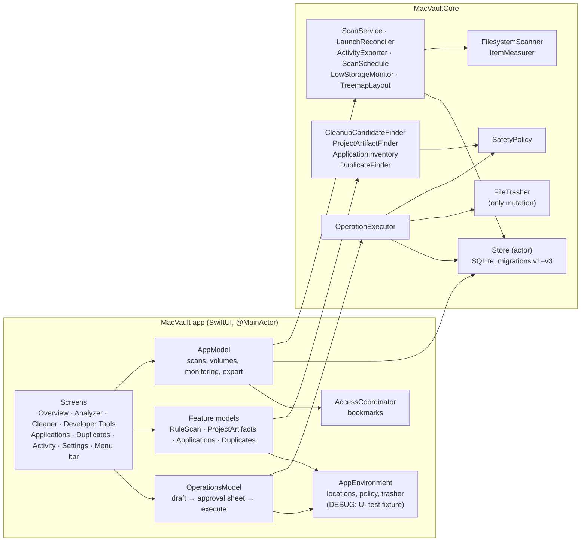

# MacVault Architecture

MacVault is a native macOS storage app. It measures what uses space, then helps you remove caches, build output, unused apps and duplicate files — but only items you reviewed and approved, and only by moving them to the Trash. Everything runs locally; nothing is sent anywhere.

The design decisions behind this document, and their trade-offs, are recorded as ADRs in [DECISIONS.md](DECISIONS.md). Edition differences are in [CAPABILITY_MATRIX.md](CAPABILITY_MATRIX.md). What is verified is in [FEATURE_STATUS.md](FEATURE_STATUS.md).

## 1. Shape of the system

Two modules with a one-way dependency:

| Module | Platform | Contains | Depends on |
|---|---|---|---|
| `MacVaultCore` (SwiftPM library) | macOS and Linux | Domain models, scanner, finders, safety policy, executor, SQLite store, services | `CSQLite` (system SQLite) |
| `MacVault` app (SwiftUI) | macOS 14+ | Screens, view models, folder access (bookmarks), notifications, menu bar | `MacVaultCore` |

The rule that keeps this safe: **the app never touches the filesystem for removal.** Screens build candidate lists by calling core finders, and hand approved lists to the core executor. All safety-critical logic is in the core, where it is unit-tested without UI.



## 2. Source layout

```
Sources/MacVaultCore/
  Domain/          Models (scan, findings, volumes, audit), Operations (manifests, items,
                   candidates), Applications, Errors
  Filesystem/      FileSystemProbe (read-only lstat/readdir), FilesystemScanner, ItemMeasurer
  Safety/          SafetyPolicy, OperationExecutor + FileTrasher
  Cleanup/         CleanupRules (versioned catalog), CleanupCandidateFinder, ProjectArtifactFinder
  Applications/    ApplicationInventory (bundles + ~/Library leftovers)
  Duplicates/      DuplicateFinder
  Persistence/     SQLiteConnection, Migrations, Store, Store+Operations
  Services/        ScanService, LaunchReconciler, ActivityExporter, Monitoring
  Support/         ByteFormat, Timestamp, PathUtilities, ContentHasher (SHA-256), TreemapLayout
  Volume/          VolumeInfoService
Sources/MacVaultApp/
  App/             MacVaultApp (scenes, menu bar), AppModel, OperationsModel, FeatureModels,
                   AccessCoordinator, AppSettings, AppEnvironment, Notifier
  Features/        one file per screen, plus the permissions sheet
  Components/      views shared by screens: ReviewComponents (rows, approval sheet, status, history),
                   BreakdownViews (drill-down list, treemap), StartScreen
  DesignSystem/    spacing, cards, badges, banners
Tests/MacVaultCoreTests/   core unit + isolated-filesystem integration tests
Tests/MacVaultUITests/     XCUITest end-to-end flows against a fixture
```

## 3. Read path: scanning

```mermaid
sequenceDiagram
  participant UI as Storage Analyzer
  participant AM as AppModel
  participant AC as AccessCoordinator
  participant SS as ScanService
  participant FS as FilesystemScanner
  participant DB as Store
  UI->>AM: startScan()
  AM->>AM: scanPhase = running (synchronously; refuses a second start)
  AM->>AC: beginAccess(location) (security-scoped bookmark)
  AM->>SS: runScan(config)
  SS->>DB: createScanSession (status running) + audit scan.started
  SS->>FS: scan(config) — lstat/readdir, explicit stack
  loop every ≥250 ms (awaited = backpressure)
    FS-->>SS: progress
    SS->>DB: updateScanProgress
    SS-->>AM: progress → UI
  end
  FS-->>SS: ScanResult (counters, large files, top level, tree, issues)
  SS->>DB: finishScan (one transaction) + snapshot + audit outcome
  AM->>AC: stop access
```

Scanner guarantees: symlinks are never followed; other volumes are not entered (by default); hard links are sized once; every unreadable item is counted, and any unreadable item makes the scan `partial`, never `completed`; cancellation returns what was observed as `cancelled`. Only bounded data is persisted: the 500 largest files, the root's children, a drill-down tree of directories up to 4 levels (largest 4,000 kept, always with their ancestors), and the first 200 issues.

## 4. Write path: review → approve → move to Trash

This is the only path that changes user files.

```mermaid
sequenceDiagram
  participant S as Feature screen
  participant F as Finder (core, read-only)
  participant OM as OperationsModel
  participant DB as Store
  participant Sheet as Approval sheet
  participant EX as OperationExecutor
  participant P as SafetyPolicy
  participant T as FileTrasher
  S->>F: find candidates
  F->>P: evaluate each path (1st check)
  F-->>S: RemovalCandidates (path, device:inode, size, risk, reason, scope)
  S->>OM: review(selected)
  OM->>DB: createManifest (status draft) + audit operation.reviewed
  OM->>Sheet: show exact items, sizes, risks
  alt user cancels
    Sheet->>OM: discard → manifest discarded, nothing touched
  else user approves (high risk needs an extra acknowledgement)
    Sheet->>OM: approve
    OM->>DB: draft → approved (once only)
    OM->>EX: execute(manifestId)
    EX->>DB: approved → executing (atomic; a second execute fails)
    loop each item, one at a time
      EX->>P: evaluate again (2nd check)
      EX->>EX: revalidate: parents canonical, exists, not symlink,<br/>same device:inode, kind, not in use; duplicates re-hashed
      alt all checks pass
        EX->>T: moveToTrash
      else
        EX->>EX: mark skipped with reason
      end
      EX->>DB: persist outcome before the next item (stop if this fails)
    end
    EX->>DB: executing → completed / partial / nothingMoved / failed / cancelled
  end
```

### Safety layers

| Layer | Where | What it guarantees |
|---|---|---|
| Single mutation point | `FileTrasher`, used only by `OperationExecutor` | Nothing in MacVault deletes; items go to the Trash and can be put back |
| Read-only discovery | `FileSystemProbe` (lstat, readdir) | Finders and the scanner can't change files |
| Path policy | `SafetyPolicy` (pure string logic) | System locations, home and its standard folders, top-level Library folders, credentials (.ssh, keychains, signing assets), version control, sync roots, app/library packages, other users and MacVault's own data are never allowed. Each item must be inside its recorded scope folder |
| Approval gate | `Store` state machine | draft → approved → executing are compare-and-set transitions; a list is approved once and executed once |
| Revalidation | `OperationExecutor.revalidate` | The item moved is the item reviewed: same identity, no symlink swapped into its path, not in use, duplicates still identical, kept copy still present |
| Durable record | `Store.updateOperationItem` per item | Every outcome is saved before the next item; if saving fails, execution stops. Interrupted runs are reconciled on next launch |
| Honest reporting | manifests, banners | Reports measured size moved, never "space freed" (Trash still uses space; APFS clones share blocks) |
| Edition limit | App Store build | Read-only entitlement: review only, no moves |

## 5. Persistence

One SQLite database (`~/Library/Application Support/MacVault/macvault.sqlite`, or the app container when sandboxed), owned by the `Store` actor (WAL mode, foreign keys on). Each migration runs in its own transaction; a failed migration leaves the previous version intact.

| Version | Adds |
|---|---|
| v1 | `volumes`, `scan_sessions`, `file_findings`, `applications`, `operation_manifests`, `operation_items`, `audit_events`, `storage_snapshots` |
| v2 | Scan coverage columns, `scan_directory_aggregates`, `scan_issues` |
| v3 | `scan_tree_nodes` (drill-down), review detail on operation items (rule, risk, reason, scope, content hash, kept copy, message, position), manifest title and failure reason, unique application paths |

Settings and folder bookmarks are in `UserDefaults` (a private suite in UI test mode). The audit log is append-only and survives "Delete Scan History".

## 6. Concurrency

- UI state lives in `@MainActor @Observable` models.
- File work runs off the main actor through `offMain`, which forwards cancellation (unlike a bare `Task.detached`).
- `Store` is an actor over a single connection, so database access is serialized.
- The scanner and executor check `Task.isCancelled` cooperatively. Cancelling a scan records it as `cancelled`; cancelling an execution stops after the current item and leaves the rest untouched.
- Scans are single-flight: `startScan` enters the running state synchronously, and a scheduled multi-folder run holds `isScanning` for its whole duration.

## 7. Background behaviour

While the app is open (including from the menu bar), `AppModel` runs a monitor every 10 minutes. It refreshes volume capacity (rate-limited snapshots), evaluates `LowStorageMonitor` (warns once per drop, re-arms after recovery) and runs due `ScanSchedule` scans. These are read-only. Notifications need the bundled app; every warning is also written to Activity.

## 8. Editions

One codebase, selected by the `APPSTORE` compilation condition (see [CAPABILITY_MATRIX.md](CAPABILITY_MATRIX.md)). Direct: not sandboxed, hardened runtime, can move approved items. App Store: sandboxed, read-only access to folders you choose, review-only.

## 9. Testing

| Suite | What it covers | How it stays safe |
|---|---|---|
| `MacVaultCoreTests` (`swift test`) | Scanner, persistence and migrations, policy against the real system roots, executor revalidation and failure paths, finders, hashing vectors, export, treemap, monitoring | Every filesystem test runs inside a `TempTree`; the Trash is a `FakeTrash` folder |
| `MacVaultUITests` (Xcode, `MacVault-Direct` scheme) | End-to-end screens: scan/drill-down/treemap, cleaner cancel and approve, high-risk acknowledgement, project build folders, duplicates, app vs leftover removal, settings and export | `-MacVaultUITesting` (DEBUG only) points database, settings, home, Applications and Trash at a per-test fixture via `AppEnvironment` |
| Perf smoke (opt-in) | Scanner throughput on a real tree | Read-only |

UI test mode needs all five `MACVAULT_*` variables (`DB_PATH`, `HOME`, `LOCATIONS`, `APPLICATIONS`, `TRASH_DIR`). The fixture is the folder that contains `MACVAULT_HOME`; `DB_PATH`, `TRASH_DIR`, `APPLICATIONS` and every colon-separated `LOCATIONS` entry must be inside it. If any variable is missing, the fixture home is inside a system root, the fixture home or the fixture is (or contains) the real home folder, or any of those paths is outside the fixture, the app stops at launch with a `preconditionFailure` instead of falling back to the real database, home or Trash. Every default system root still applies to the fixture. Settings are kept in the `com.macvault.uitests` defaults suite (`~/Library/Preferences/com.macvault.uitests.plist`), which is emptied at every test launch; MacVault's settings and bookmarks in the app's own domain are not used.

Project agents in `.claude/agents/`: `macvault-verifier` (build and test, read-only), `macvault-reviewer` (code review, read-only), `macvault-qa-tester` (writes tests), `macvault-bugfixer` (fixes with regression tests), and `macvault-qa` (all four in one loop). The manager is the `/macvault-manager` skill (`.claude/skills/macvault-manager/`): it runs in the main session, because subagents can't launch other subagents. It dispatches verifier → reviewer + QA tester (in parallel) → bug fixer → verifier, looping until clean.

## 10. Extending

- **New cleanup rule:** add a `CleanupRule` to `RuleCatalog`, bump `RuleCatalog.version`, and keep `selectedByDefault` false unless the risk is low. `SafetyPolicyTests.testEveryBuiltInRuleTargetsAnAllowedLocation` must pass.
- **New removal feature:** write a read-only finder in the core that returns `RemovalCandidate`s with a scope folder. If it needs its own rules, add an `OperationType` and its scope handling in `SafetyPolicy`. In the app, call `OperationsModel.review(...)`. Never call the executor or the filesystem from a screen.
- **Schema change:** add a new migration; never edit a shipped one. Add an upgrade test from the previous version.
