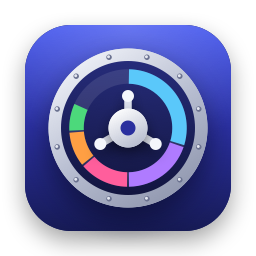
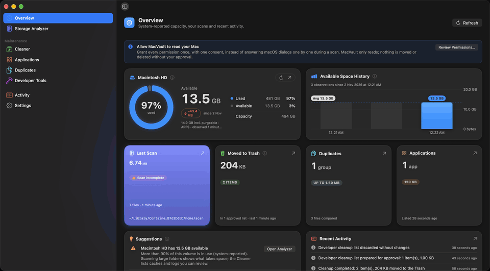
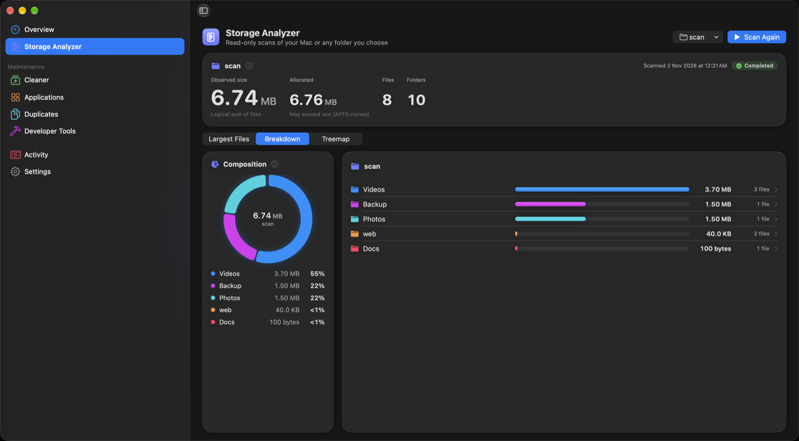
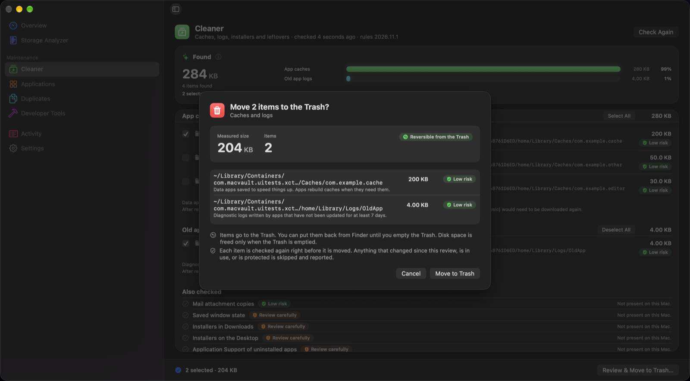
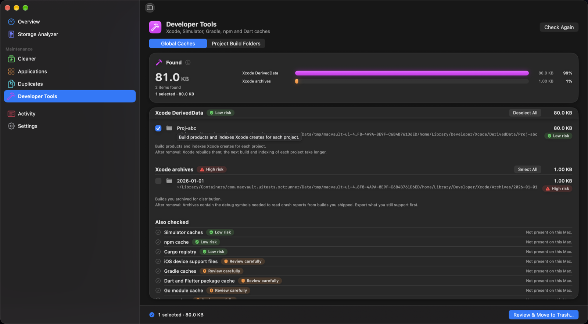
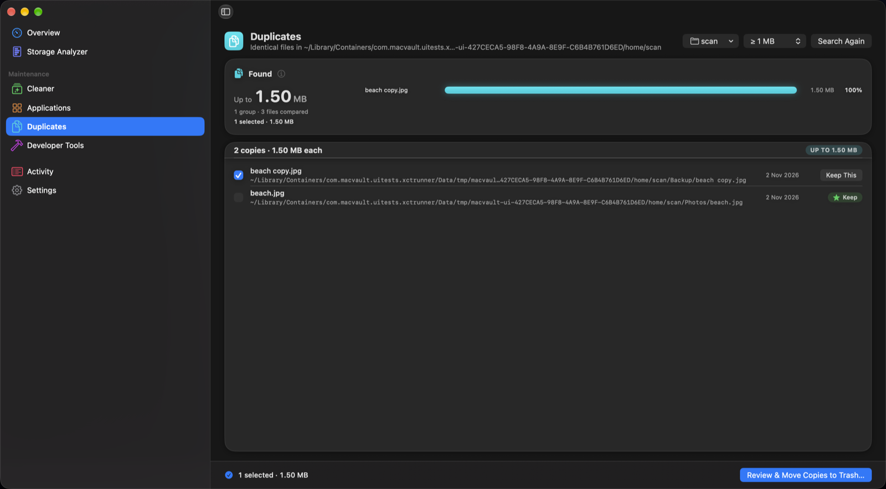
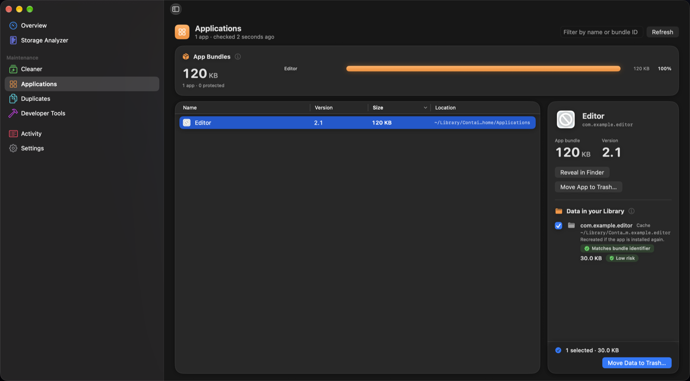
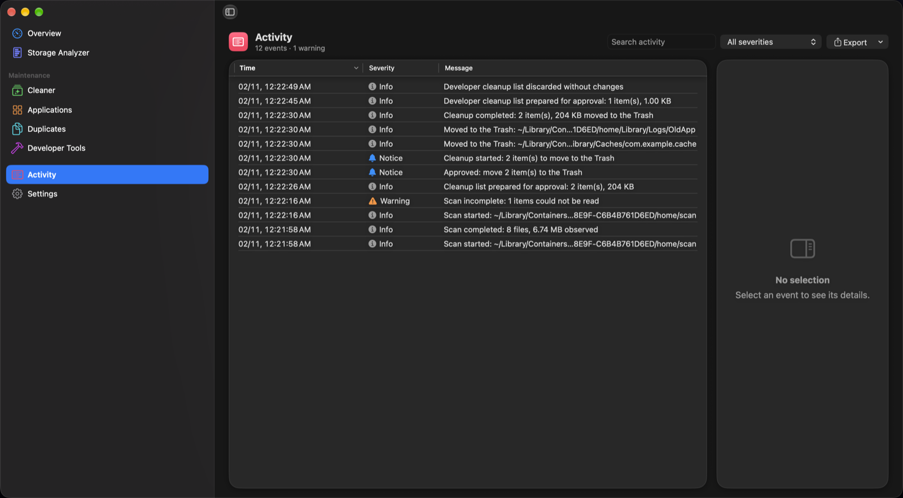
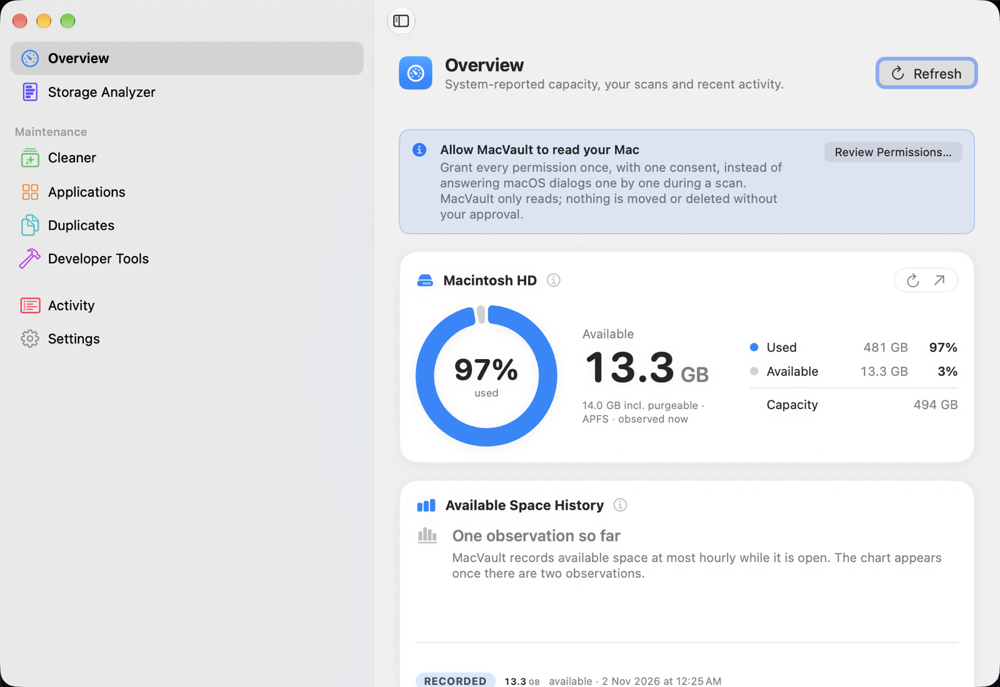

<div align="center">



# MacVault

**See what's filling your Mac's disk, then clear it safely.**

A native, local-only macOS app. You review every item, and approved items go to the Trash. Nothing is deleted outright.

[](https://github.com/om-chauhan/MacVault/actions/workflows/build.yml)
[](https://github.com/om-chauhan/MacVault/releases/latest)
[](LICENSE)
[](#install)
[](Package.swift)
[](#how-it-stays-safe)

**[Download for macOS](https://github.com/om-chauhan/MacVault/releases/latest/download/MacVault.dmg)** · [Features](#features) · [How it stays safe](#how-it-stays-safe) · [Screenshots](#screenshots) · [Build from source](#build-from-source)



<sub>Real app screens, running on sample test data.</sub>

</div>

> [!NOTE]
> **MacVault is at an early stage.** The logic that decides what can be moved has thorough automated tests, but the app hasn't had much real-world use yet. Start with a folder you don't mind experimenting on. [FEATURE_STATUS.md](Documentation/FEATURE_STATUS.md) lists exactly what has been verified.

## Features

| Screen | What it does |
|---|---|
| **Overview** | Shows capacity, used and available space for each volume, with a history of available space |
| **Storage Analyzer** | Scans your whole Mac or a folder you choose, read-only, with drill-down, a treemap and your largest files |
| **Cleaner** | Finds app caches, old logs, Mail attachment copies, saved window state, old installers in Downloads and on the Desktop, and leftovers from uninstalled apps |
| **Developer Tools** | Finds Xcode DerivedData and Archives, Simulator and device support files, and npm, pnpm, Cargo, Go, Maven, Gradle and Dart caches. Also finds build folders such as `node_modules` and `target`, offered only next to their project files |
| **Applications** | Lists installed apps. Removing an app and removing its leftover data are separate steps |
| **Duplicates** | Finds identical files, confirmed with SHA-256, and lets you choose which copy to keep |
| **Activity** | Keeps a searchable log of every scan, approval and move, exportable as JSON or CSV with optional redaction of your home folder and account name |
| **Menu bar** | Shows capacity and quick actions, and runs optional scheduled scans and low-storage alerts while the app is open |

## How it stays safe

- **Scanning is read-only.** Scans don't follow symbolic links. If a scan can't read something, it says so and is labelled incomplete.
- **Nothing moves without your approval.** Each list shows the exact items, sizes and risks, and high-risk items need an extra confirmation.
- **Items only go to the Trash.** You can put them back until you empty it. The only thing MacVault deletes itself is its own scan history, when you ask it to.
- **Everything is checked again before it moves.** Right before moving an item, MacVault confirms it's the same file you reviewed and isn't in use or protected. Duplicates are re-hashed on both sides. Anything that changed is skipped and reported.
- **Sensitive data is off limits.** Protected locations include system folders, Git data, SSH and cloud credentials, keychains, signing certificates, Mail, Messages, iCloud Drive and your Photos and Music libraries.
- **Your data stays on your Mac.** There's no network code, telemetry or account.
- **The numbers are honest.** Sizes are measured or reported by the system, and MacVault never claims "space freed", because the Trash still uses space until you empty it.

The design behind these guarantees is explained in [ARCHITECTURE.md](Documentation/ARCHITECTURE.md).

## Screenshots

<table>
  <tr>
    <td width="50%"><br><b>Overview:</b> your disk at a glance</td>
    <td width="50%"><br><b>Storage Analyzer:</b> where the space went</td>
  </tr>
  <tr>
    <td><br><b>Approval sheet:</b> the same review for every removal</td>
    <td><br><b>Developer Tools:</b> every item labelled by risk</td>
  </tr>
  <tr>
    <td><br><b>Duplicates:</b> you choose which copy stays</td>
    <td><br><b>Applications:</b> apps and their data, handled separately</td>
  </tr>
  <tr>
    <td><br><b>Activity:</b> a record of everything it did</td>
    <td><br><b>Light and dark:</b> follows your system appearance</td>
  </tr>
</table>

## Install

MacVault needs macOS 14 Sonoma or later. It's a universal build for Apple silicon and Intel, so far tested on Apple silicon only.

1. Download **[MacVault.dmg](https://github.com/om-chauhan/MacVault/releases/latest/download/MacVault.dmg)** from the [latest release](https://github.com/om-chauhan/MacVault/releases/latest). A `.zip` is also available there.
2. Open it and drag MacVault to **Applications**.
3. Builds aren't notarized by Apple yet, so macOS blocks the app when you first open it. If you trust this download, clear the download flag:

   ```bash
   xattr -dr com.apple.quarantine /Applications/MacVault.app
   ```

   If you'd rather not do that, [build it from source](#build-from-source).

On first launch, MacVault explains the permissions it can use. Scanning your whole Mac needs Full Disk Access, which you grant in System Settings. Without it, MacVault reports folders it couldn't read and labels the scan incomplete.

## Build from source

You'll need macOS 14 or later and Xcode 16 or later.

```bash
git clone https://github.com/om-chauhan/MacVault.git
cd MacVault
swift test                # run the core test suite
swift run MacVaultApp     # launch the app, unbundled
```

For the bundled app, which is needed for the app icon in Finder and for notifications, generate the Xcode project with [XcodeGen](https://github.com/yonaskolb/XcodeGen):

```bash
brew install xcodegen
xcodegen generate
open MacVault.xcodeproj
```

There are two schemes. `MacVault-Direct` is the full app. `MacVault-AppStore` is sandboxed and review-only, so it can't move items. See [CAPABILITY_MATRIX.md](Documentation/CAPABILITY_MATRIX.md) for the differences.

## Project structure

```
MacVault/
├── Sources/
│   ├── MacVaultCore/        Scanner, finders, safety policy, executor and SQLite store (no UI)
│   ├── MacVaultApp/         The SwiftUI app
│   │   ├── App/             Scenes, app state and view models
│   │   ├── Features/        One file per screen
│   │   ├── Components/      Views shared across screens
│   │   ├── DesignSystem/    Spacing, cards, badges and banners
│   │   └── Resources/       Icon for unbundled runs
│   └── CSQLite/             System SQLite module map
├── Tests/
│   ├── MacVaultCoreTests/   Unit, filesystem integration and safety tests
│   └── MacVaultUITests/     End-to-end flows and screenshot capture
├── Config/                  Entitlements, privacy manifest and app icon
├── Documentation/           Architecture, decisions, design, status and images
├── Scripts/                 Icon generator and screenshot capture
├── .github/workflows/       CI and automatic releases
├── Package.swift            SwiftPM manifest
└── project.yml              XcodeGen project spec
```

## Documentation

| Document | What's in it |
|---|---|
| [ARCHITECTURE.md](Documentation/ARCHITECTURE.md) | How the system fits together and how the safety model works |
| [DECISIONS.md](Documentation/DECISIONS.md) | Why it's built this way, with the trade-offs |
| [FEATURE_STATUS.md](Documentation/FEATURE_STATUS.md) | What's implemented and how it was verified |
| [CAPABILITY_MATRIX.md](Documentation/CAPABILITY_MATRIX.md) | Differences between the Direct and App Store editions |
| [PRD.md](Documentation/PRD.md) | Product requirements and acceptance criteria |
| [DESIGN.md](Documentation/DESIGN.md) | The visual language |
| [MILESTONES.md](Documentation/MILESTONES.md) | Past milestone reports |

## Roadmap

- Developer ID signing and notarization, so downloads open without a warning
- Verify the App Store edition's sandbox and folder access on a signed build
- More real-world testing across every screen

## Contributing

Bug reports, fixes and new cleanup rules are welcome. [CONTRIBUTING.md](CONTRIBUTING.md) covers setup, the checks to run and the safety rules every change has to keep. To report a security problem, follow [SECURITY.md](SECURITY.md).

## License

[MIT](LICENSE) © 2026 Omprakash Chauhan

MacVault isn't affiliated with or endorsed by Apple Inc. Mac and macOS are trademarks of Apple Inc.
